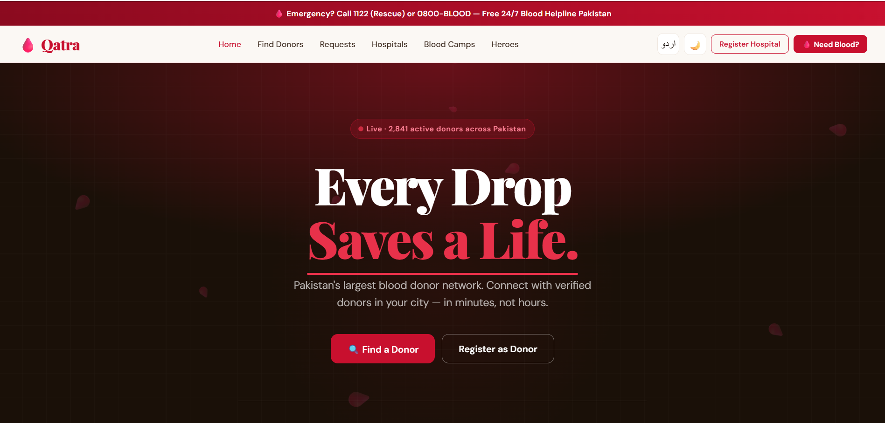
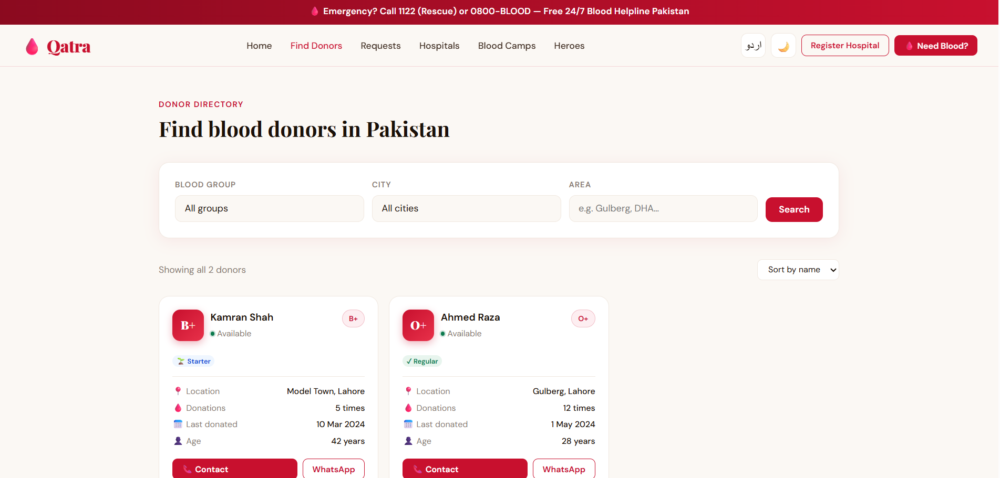

<h1 align="center">Qatra 🩸</h1>

<p align="center"><b>A blood donation platform that connects donors, hospitals and people in urgent need of blood.</b></p>

<p align="center">
  
  
  
  
</p>

<p align="center">
  <a href="#preview">Preview</a> ·
  <a href="#features">Features</a> ·
  <a href="#quick-start">Quick start</a> ·
  <a href="#admin-area">Admin area</a> ·
  <a href="#project-structure">Structure</a>
</p>

---

## What is Qatra?

Qatra ("drop" in Urdu) helps people find blood donors quickly. Donors can register, hospitals can list themselves and post blood requests, and anyone can browse upcoming blood camps. All data is stored in MySQL through a PHP backend.

## Preview

**Home**



**Find Donors**



**Hospitals**


**Blood Camps**


**Admin dashboard** (front-end preview panel)


## Features

| Feature | What it does |
|---|---|
| Find Donors | Loads the donor list from MySQL |
| Donor registration | Saves the registration form to MySQL |
| Hospitals | Hospital list and hospital registration, both backed by MySQL |
| Blood requests | "Need Blood?" form saves requests; shown on home and Requests pages |
| Blood camps | Upcoming camps loaded from MySQL |
| Admin login | Session-based authentication with bcrypt password hashing |
| Protected records page | After login, shows all 5 database tables |

## Tech stack

- **Frontend:** HTML, CSS, JavaScript
- **Backend:** PHP
- **Database:** MySQL
- **Local server:** XAMPP (Apache + MySQL)

## Quick start

1. Install [XAMPP](https://www.apachefriends.org) and start **Apache** and **MySQL**.
2. Copy this folder into `htdocs`:
   - Windows: `C:\xampp\htdocs\qatra-project`
   - Mac: `/Applications/XAMPP/htdocs/qatra-project`
3. Open `http://localhost/phpmyadmin` → **Import** → choose `database/schema.sql` → **Go**.
4. If `backend/config.example.php` exists, copy it to `backend/config.php` and fill in your database settings.
5. Open `http://localhost/qatra-project/index.html`.

> Open the site through `localhost`, not by double-clicking the HTML file, otherwise the API calls will not work.

## Admin area

Open `http://localhost/qatra-project/backend/login.php`.

After login you land on `records.php`, which lists every row of `donors`, `hospitals`, `hospital_inventory`, `blood_requests` and `camps`. Opening `records.php` without logging in redirects back to the login page.

> The default credentials in `schema.sql` are for **local testing only**. Change them before using this anywhere public.

The "Admin" tab inside `index.html` is a front-end-only preview with sample data. The real protected admin area is `backend/login.php` and `backend/records.php`.

## Project structure

```
qatra-project/
├── index.html              # Frontend
├── assets/                 # README screenshots
├── backend/
│   ├── config.php          # Database connection (not committed)
│   ├── donors.php          # Donor list + registration API
│   ├── hospitals.php       # Hospital list + registration API
│   ├── requests.php        # Blood request list + posting API
│   ├── camps.php           # Blood camp list API
│   ├── login.php           # Admin login
│   └── records.php         # Protected records page
└── database/
    └── schema.sql          # Creates qatra_db + tables + sample data
```

## Roadmap

- [ ] Hospital blood inventory form (table `hospital_inventory` already exists)
- [ ] Connect admin dashboard preview numbers to live database counts
- [ ] Donor leaderboard and badges

## Troubleshooting

- **"Could not load donors"** → Apache/MySQL not running, database not imported, or the file was opened directly instead of via `localhost`.
- **Garbled emoji or characters** → import `schema.sql` with the `utf8mb4` charset in phpMyAdmin.
- **CORS error** → use `http://localhost/...` for both frontend and backend.

## Author

**Momina Shaheen**
GitHub: [@momina-shaheen](https://github.com/momina-shaheen) · LinkedIn: [momina-shaheenn](https://www.linkedin.com/in/momina-shaheenn)
