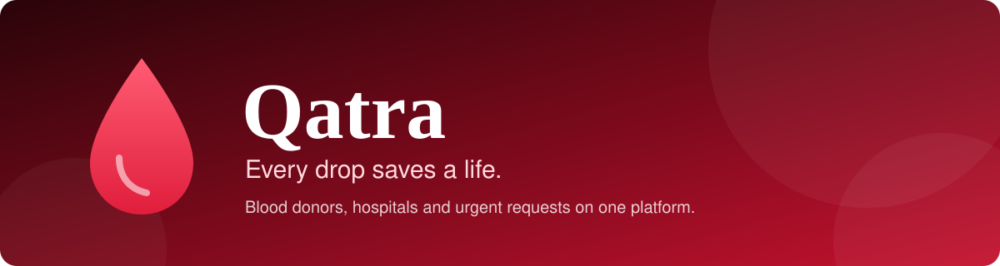
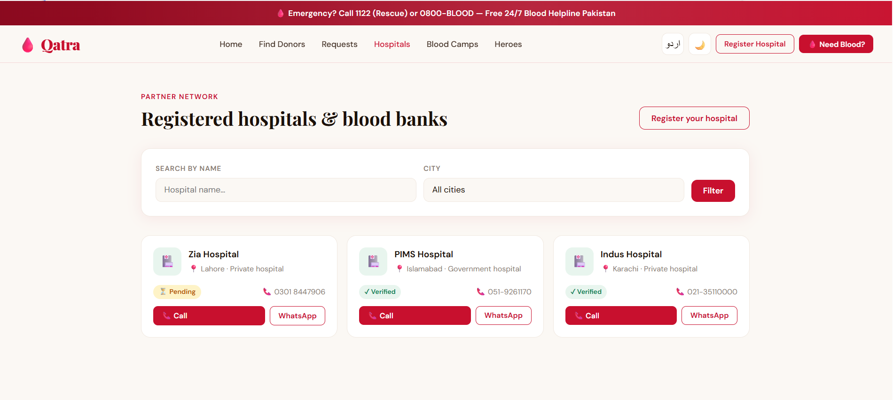
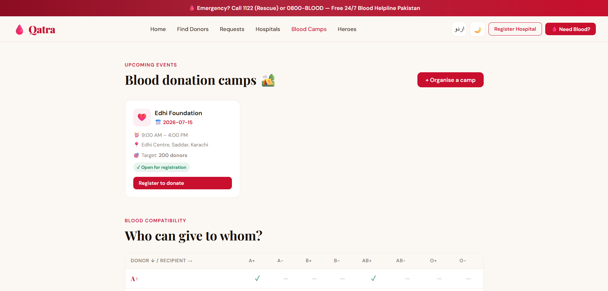
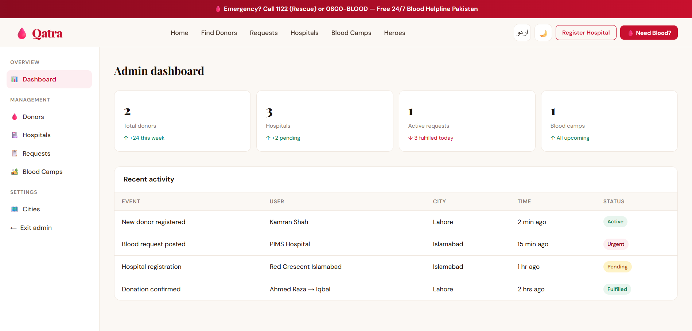
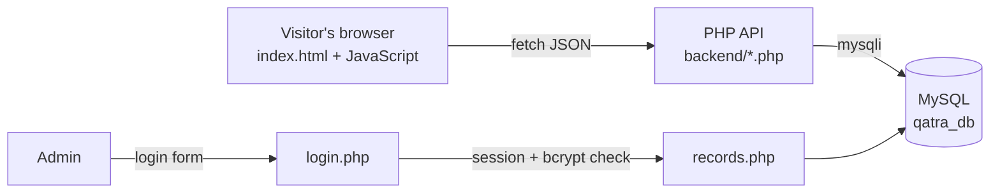
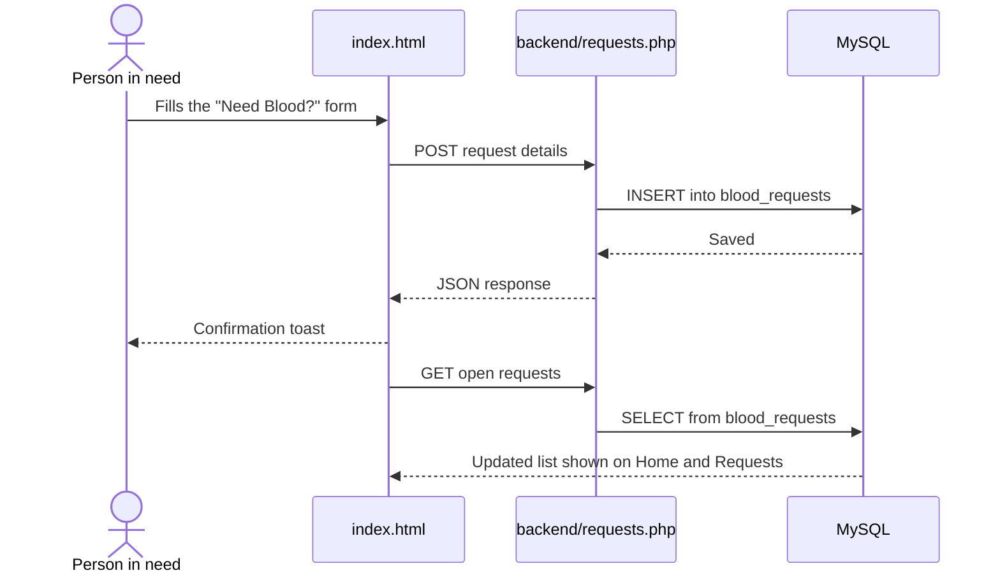
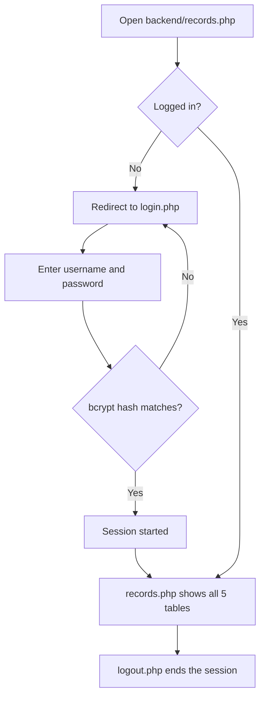

<p align="center">
 
</p>

<p align="center">
  <b>A blood donation platform that connects donors, hospitals and people in urgent need of blood.</b><br>
  Built with PHP, MySQL and vanilla JavaScript.
</p>

<p align="center">
  
  
  
  
  
</p>

<p align="center">
  <a href="#what-is-qatra">What is Qatra?</a> ·
  <a href="#product-preview">Preview</a> ·
  <a href="#highlights">Highlights</a> ·
  <a href="#how-it-works">How it works</a> ·
  <a href="#quick-start">Quick start</a> ·
  <a href="#admin-area">Admin</a> ·
  <a href="#api-reference">API</a> ·
  <a href="#project-structure">Structure</a>
</p>

---

## What is Qatra?

*Qatra* means "a drop" in Urdu. In an emergency, finding a matching blood donor usually means a flurry of phone calls and forwarded messages. Qatra puts that process in one place:

- **Donors** register once and become searchable by blood group and city.
- **Hospitals** register themselves and post urgent blood requests.
- **Anyone** can browse donors, open requests and upcoming blood camps.
- **Admins** sign in to a protected area and see every record stored in the database.

Everything is stored in MySQL through a small PHP API, so the data survives page reloads and server restarts.

## Product preview

<table>
  <tr>
    <td align="center" width="50%"><b>Home</b><br></td>
    <td align="center" width="50%"><b>Find Donors</b><br></td>
  </tr>
  <tr>
    <td align="center"><b>Hospitals</b><br></td>
    <td align="center"><b>Blood Camps</b><br></td>
  </tr>
</table>

**Admin dashboard** (front-end preview panel inside `index.html`)



## Highlights

| Capability | What it does |
|---|---|
| **Donor search** | Loads the donor list from MySQL on the Find Donors page |
| **Donor registration** | The "Register as donor" form saves a new donor row to the database |
| **Hospital directory** | Lists registered hospitals and lets a hospital register itself |
| **Blood requests** | The "Need Blood?" form posts a request that appears on the home and Requests pages |
| **Blood camps** | Upcoming camps are loaded from the database |
| **Heroes / leaderboard** | Ranks and badges are computed in the browser from the donor list, with no extra backend call |
| **Emergency banner** | Helpline information is always visible at the top of the site |
| **Language and theme controls** | Urdu / English and light / dark toggle buttons in the header |
| **Protected admin area** | Session-based login with bcrypt password hashing |
| **Records page** | After login, shows every row of all five tables, so you can verify data is really stored |
| **Same-origin API** | Frontend and backend run on the same `localhost` origin, so no CORS setup is needed |

## How it works

### Architecture



### Posting a blood request



### Admin access



## Pages

| Page | Purpose |
|---|---|
| **Home** | Hero section, emergency banner and the latest blood requests |
| **Find Donors** | Browse registered donors and register as a new donor |
| **Requests** | All blood requests, plus the "Need Blood?" form |
| **Hospitals** | Hospital directory and hospital registration |
| **Blood Camps** | Upcoming donation camps |
| **Heroes** | Donor leaderboard with ranks and badges |
| **Admin (preview)** | Front-end-only dashboard panel with sample data |
| **`backend/login.php`** | The real, protected admin area (see below) |

## Quick start

### Requirements

- [XAMPP](https://www.apachefriends.org) (Apache + MySQL) or any PHP + MySQL stack
- A modern browser

### Setup

1. **Start XAMPP.** Run **Apache** and **MySQL** from the XAMPP Control Panel.
2. **Copy the project** into `htdocs`:
   - Windows: `C:\xampp\htdocs\qatra-project`
   - Mac: `/Applications/XAMPP/htdocs/qatra-project`

   > Keep the folder name `qatra-project` so the URLs below work.
3. **Create the database.** Open `http://localhost/phpmyadmin` → **Import** → choose `database/schema.sql` → **Go**. This creates `qatra_db` with all tables and a little sample data.
4. **Open the site:** `http://localhost/qatra-project/index.html`

> Always open the site through `localhost`. Double-clicking `index.html` will not work, because the API calls need Apache and PHP.

### Database configuration

`backend/config.php` uses the XAMPP defaults:

```php
$DB_HOST = "localhost";
$DB_USER = "root";
$DB_PASS = "";
$DB_NAME = "qatra_db";
```

If your MySQL setup is different, edit these values.

## Admin area

Open `http://localhost/qatra-project/backend/login.php`.

After signing in you land on `records.php`, which lists every row in `donors`, `hospitals`, `hospital_inventory`, `blood_requests` and `camps`. Opening `records.php` without logging in redirects you back to the login page.

The default credentials are created by `database/schema.sql` and are meant for **local testing only**. Change them before putting this anywhere public.

> The "Admin" tab inside `index.html` is a front-end-only preview with sample numbers. The real protected area is `backend/login.php` and `backend/records.php`.

## Database

| Table | Stores |
|---|---|
| `donors` | Registered blood donors |
| `hospitals` | Registered hospitals |
| `hospital_inventory` | Blood stock per hospital (table ready, form not wired yet) |
| `blood_requests` | Blood requests posted through the site |
| `camps` | Blood donation camps |

The connection uses `utf8mb4`, so Urdu text and emoji are stored correctly.

## API reference

All endpoints live in `backend/` and return JSON.

| Endpoint | Method | Purpose |
|---|---|---|
| `donors.php` | GET / POST | List donors / register a donor |
| `hospitals.php` | GET / POST | List hospitals / register a hospital |
| `requests.php` | GET / POST | List blood requests / post a new request |
| `camps.php` | GET | List blood camps |
| `login.php` | GET / POST | Admin login form and credential check |
| `logout.php` | GET | End the admin session |
| `records.php` | GET | Protected view of all tables (login required) |
| `auth.php` | - | Shared session check used by protected pages |

## Project structure

```
qatra-project/
├── index.html                 # Frontend (all pages, styles and JavaScript)
├── README.md
├── assets/
│   ├── qatra-banner.svg       # README banner
│   ├── home.png               # Screenshots used in this README
│   ├── donors.png
│   ├── hospitals.png
│   ├── bloodcamp.png
│   └── admin-records.png
├── backend/
│   ├── config.php             # Database connection (XAMPP defaults)
│   ├── auth.php               # Session check for protected pages
│   ├── login.php              # Admin login
│   ├── logout.php             # Admin logout
│   ├── records.php            # Protected records page
│   ├── donors.php             # Donor list + registration API
│   ├── hospitals.php          # Hospital list + registration API
│   ├── requests.php           # Blood request list + posting API
│   └── camps.php              # Blood camp list API
└── database/
    └── schema.sql             # Creates qatra_db, tables and sample data
```

## Current status

| Done | Still to do |
|---|---|
| Donor list and registration | Wire a form to fill `hospital_inventory` |
| Hospital list and registration | Connect the admin dashboard preview numbers to live counts |
| Blood requests (list and post) | Request status updates (fulfilled / closed) |
| Blood camps list | Donor search filters by blood group and city on the server side |
| Admin login, sessions, bcrypt | |
| Protected records page | |

## Troubleshooting

| Problem | Fix |
|---|---|
| "Could not load donors" toast | Apache or MySQL is not running, the database was not imported, or the file was opened directly instead of through `localhost` |
| Blank page or errors | Open DevTools (F12) → **Console** and read the exact error |
| CORS error | Use `http://localhost/...` for both frontend and backend |
| Emoji or Urdu text looks broken | Import `schema.sql` with the `utf8mb4` charset selected in phpMyAdmin |
| Admin login keeps redirecting | Make sure cookies are enabled and you are using the same `localhost` address throughout |

## Author

**Momina Shaheen**
GitHub: [@momina-shaheen](https://github.com/momina-shaheen) · LinkedIn: [momina-shaheenn](https://www.linkedin.com/in/momina-shaheenn)

---

<p align="center"><b>Qatra</b>: every drop saves a life. 🩸</p>
